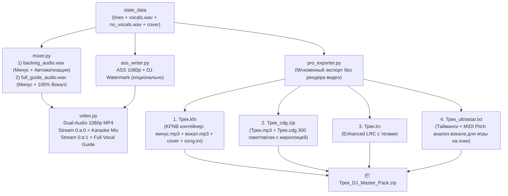

# AI Karaoke Studio: Анализ рынка проф. караоке, Маркетинговое позиционирование и Технический план DJ/KJ-интеграции

Этот документ объединяет исследование рынка профессионального караоке-оборудования и DJ-софта, готовые тезисы для рекламных материалов и лендинга, а также детальный технический план реализации универсального экспорта («комбайна на все случаи жизни»).

---

## Часть 1. Как устроен рынок профессионального караоке («железо» vs клубный DJ/KJ софт)

На рынке караоке в РФ/СНГ и мире существуют **три разных сегмента**, у каждого из которых свои стандарты оборудования и свои острые боли:

### 1. Закрытые «железные» караоке-машины (AST-250 / AST-50, Studio Evolution Pro2 / EvoBox)
Стоят в дорогих классических караоке-ресторанах (стоимость аппаратов — от 250 000 до 600 000 ₽).
* **Как работают:** Внутри закрытая зашифрованная база на Linux. Вставить флешку со своей песней и синхронным текстом напрямую в аппарат **технически заблокировано** производителем (производители зарабатывают на продаже пакетов обновлений по 50–100 тыс. ₽ в год).
* **Главная боль клубов с AST / Evolution:** Свежие хиты, русский рэп, локальные мемы, инди, тренды TikTok и каверы попадают в официальные базы с задержкой **от 1 до 6 месяцев** (а многие треки не попадают вообще).
* **Как звукорежиссёры в таких клубах решают проблему (наше окно входа):** Рядом с аппаратом AST у звукорежиссёра всегда стоит рабочий ноутбук, подключенный ко второму HDMI-входу видеосплиттера и к микшерному пульту. Когда гость за столом заказывает свежий трек (и готов платить за внеочередной заказ), звукач запускает его с ноутбука в **EnCore!**, **KaraFun** или **VLC**.

### 2. Профессиональный KJ / DJ софт (Караоке-бары, лофты, ведущие свадеб и корпоративов, мобильные диджеи)
90% караоке-вечеринок вне премиум-ресторанов работают на ноутбуках со специализированным ПО:
1. **EnCore! Караоке (Главный стандарт в РФ и СНГ):**
   * Имеет мгновенный поиск по базе, смену тональности (pitch shifting) и темпа на лету, очередь столов, мобильное приложение заказа песен для гостей.
   * **Поддерживаемые форматы:** `.kfn` (KaraFun), `.emp` (закрытый формат), `.mp4` (в т.ч. **Dual-Audio MP4** с двумя звуковыми дорожками), `.mp3 + .lrc` (Enhanced LRC), `.cdg + .mp3`.
2. **KaraFun Player / Pro (Мировой и СНГ стандарт):**
   * **Поддерживаемые форматы:** `.kfn` (контейнер с раздельной регулировкой минуса и бэк-вокала прямо в плеере!), `.mp4`, `.zip (.mp3 + .cdg)`.
3. **VirtualDJ / Serato Video (Клубные и ивент-диджеи):**
   * **Поддерживаемые форматы:** `.mp4` (с возможностью менять тональность/BPM прямо на DJ-контроллере), `.zip (.mp3 + .cdg)`.
4. **OpenKJ (Open-source софт для караоке-баров) и UltraStar Deluxe / Play (Вокальные игры с оценкой пения по нотам):**
   * **Поддерживаемые форматы:** `.mp4`, `.zip (.mp3 + .cdg)`, `UltraStar .txt` (формат с высотой нот для баттлов на очки с микрофонами).

---

## Часть 2. Сравнение с конкурентами и рыночные ниши

| Продукт / Конкурент | Что делает | Цена на рынке | Слабые места конкурента (Наше УТП) |
| :--- | :--- | :--- | :--- |
| **Youka.io** | Облачный/десктоп генератор караоке из аудио/YouTube в MP4 | **\$10–\$30/мес** по подписке (100–300 кредитов) | Шаблонный скучный дизайн субтитров, нет 3-дорожечного таймлайна автоматизации бэк-вокала по кускам, ошибки в русской ритмике и букве «ё», облачная подписка. |
| **Croonify** | Веб/iOS генератор караоке | **\$2–\$3 за экспорт 1 трека** | Веб-версия закрылась, нет редактирования слогов, нет DJ-форматов (`.kfn`, `Dual-Audio`). |
| **Nomad Karaoke (`karaoke-gen`)** | Open-source CLI на Python | Бесплатно (CLI) / продажа готовых треков | Нет визуальной студии с таймлайном, нет клубных неоновых FX-эффектов и Apple-эмодзи, фокус на англоязычный сегмент. |
| **PowerKaraoke / Kanto** | Десктопный софт из 2000-х под Windows | **\$49–\$89** за лицензию | Устаревший интерфейс, ручная расстановка слогов, слабый встроенный AI-разделитель. |
| **Фрилансеры на Авито / Kwork («Караоке на заказ»)** | Ручная сборка `.kfn` или `.mp4` в KaraFun Studio / Vegas | **500 – 2 500 ₽ за ОДНУ песню** | Срок ожидания от 3 часов до 2 дней на одну песню, потому что тайминги ставятся вручную. |

---

## Часть 3. Шпаргалка для рекламных материалов и лендинга (УТП, боли и офферы)

### Главные киллер-фичи для промо (почему AI Karaoke Studio круче обычного видео с YouTube):
1. **🎛️ Умная 3-дорожечная студия автоматизации бэк-вокала (Эксклюзив):**
   * *Для рекламы:* «Забудьте про глухие минусовки, где непонятно, когда вступать! Оставляйте 0% голоса в простых куплетах и включайте 50% поддержку оригинального артиста на сложных распевах, бэках и припевах одним движением мышки на таймлайне».
2. **🎧 Настоящий Dual-Audio MP4 и `.KFN` для профессиональных диджеев и клубов:**
   * *Для рекламы:* «Гость на сцене растерялся и забыл мотив? Диджей в один клик включает вторую звуковую дорожку с голосом певца прямо во время воспроизведения в EnCore!, KaraFun или VirtualDJ — без остановки видео!»
3. **✨ Клубный VJ-визуал Full HD 1080p вместо приветов из 90-х:**
   * *Для рекламы:* «Адаптивный Ambilight-неон в цвет обложки трека, пульсация рамки под бит бочки, летящие нативные Apple Color Emoji и кинематографичный телесуфлер».
4. **🇷🇺 Идеальная кириллица и русский слог (Demucs + Whisper + Wav2Vec2 CTC):**
   * *Для рекламы:* «Создано специально с учетом фонетики русского языка: послоговая калибровка, авто-разбивка длинных строк и мгновенный редактор текста».
5. **🏷️ Собственный брендинг диджея, ведущего или бара:**
   * *Для рекламы:* «Зашивайте свой логотип, никнейм или контакт для заказа песен прямо в угол экрана — каждое видео работает как ваша визитка на мероприятии».
6. **🎮 Вокальные баттлы на очки (UltraStar экспорт):**
   * *Для рекламы:* «Автоматическое распознавание высоты нот вокала — экспортируйте любимые песни в UltraStar Play/Deluxe и устраивайте турниры с микрофонами дома или на вечеринке!»

### Модели монетизации проекта:
1. **Open-Core / Freemium:** Базовый проект на GitHub (приток аудитории, звезд и донатов на Boosty / CloudTips) + платная сборка **PRO DJ Edition** (или инсталлятор «в один клик» за 990–1990 ₽) с пакетным экспортом `.kfn`, `Dual-Audio MP4` и брендингом диджея.
2. **Подписочный закрытый Telegram-клуб для DJ и ведущих свадеб (500–1500 ₽/мес):** Еженедельные паки самых свежих пятничных релизов, мемов и хитов в форматах `.kfn` + `Dual-Audio 1080p MP4`, которых ещё полгода не будет в аппаратах AST/Evolution.
3. **Экспресс-изготовление кастомного караоке и свадебных/корпоративных переделок песен на заказ (500–1500 ₽ за трек):** Себестоимость по времени — 3–5 минут работы в студии.

---

## Часть 4. Карта форматов универсального экспорта

| Сегмент аудитории | Чем они пользуются | Какой формат им нужен | Что мы генерируем |
| :--- | :--- | :--- | :--- |
| **Караоке-бары и ведущие в РФ/СНГ** | **EnCore! Караоке**, **KaraFun Player/Pro**, ноутбук звукорежиссёра рядом с AST/Evolution | `.kfn` (с отдельной дорожкой бэк-вокала) и **Dual-Audio `.mp4`** | Контейнер **`.kfn`** (минус + вокал + обложка + `song.ini`) и **Dual-Audio 1080p `.mp4`** (Track 1: Минус/Авто, Track 2: Плюс 100%) |
| **Клубные и ивент-диджеи (мировая сцена)** | **VirtualDJ**, **Serato Video**, **OpenKJ**, **Siglos** | **Dual-Audio `.mp4`** и классический **`.zip` (`.mp3` + `.cdg`)** | **1080p `.mp4`** (с брендингом DJ) + стандартный архив **MP3+G (`.zip`)** с аппаратной графикой `CD+G` |
| **Домашние вечеринки и вокальные баттлы на очки** | **UltraStar Play / Deluxe**, **Performous**, **Vocaluxe** | **UltraStar `.txt` + `.mp3` + обложка** (с высотой нот для оценки пения с микрофона) | Пакет **UltraStar** с автоматическим определением высоты тона (MIDI pitch) вокала из `vocals.wav` |
| **Мобильные плееры, Smart TV, Telegram-боты** | **EnCore Android**, **Poweramp**, **AIMP**, **Foobar2000**, **VLC** | **Enhanced `.lrc`** (`[mm:ss.xx]<mm:ss.xx>слово`) + **`.ass`** + **`.mp3`** | Пословный **Enhanced `.lrc`** и телесуфлер **`.ass`** |
| **Коммерческие заказы (Авито / Свадьбы / Брендинг баров)** | Любые видеоплееры и проекторы | **1080p `.mp4` с брендингом (Watermark)** | Вшитая стильная плашка в углу экрана (например: `🎤 Karaoke by DJ Alex · @djalex`) |

---

## Часть 5. Детальный технический план реализации

### Архитектура пайплайна экспорта

Все необходимые исходные данные уже находятся в `state_data`:
* `no_vocals_wav`: чистый инструментал (WAV).
* `vocals_wav`: чистый изолированный вокал (WAV).
* `lines`: массив строк и слов `[{"text": "...", "start": 1.20, "end": 1.65}, ...]`.
* `cover_image`: обложка трека.
* `vocal_intervals` и `fx_intervals`: разметка с 3-дорожечного таймлайна.

---

### Компонент 1: Двухдорожечный звук (`Dual-Audio MP4`) для переключения Минус/Плюс на лету

1. **`src/karaoke/mixer.py`:**
   * Добавить функцию `ensure_full_guide_mix(instrumental_path: Path, vocals_path: Path, output_path: Path) -> Path`, микширующую инструментал со 100% вокалом с защитой от клиппинга до `-1.0 dBFS`.
2. **`src/karaoke/video.py`:**
   * В функцию `render_karaoke_video` добавить параметр `guide_vocal_audio: Optional[Path] = None`.
   * При наличии `guide_vocal_audio` добавить его вторым аудио-входом в FFmpeg (`-map 1:a:0 -map 2:a:0`) и прописать метаданные потоков:
     * `0:a:0`: `title="Karaoke / Instrumental"`, `disposition="default"`
     * `0:a:1`: `title="Guide Vocal (100%)"`, `disposition="0"`

---

### Компонент 2: Водяной знак / Брендинг диджея или клуба (`src/karaoke/ass_writer.py`)

* В `generate_ass_from_lines` добавить опциональный параметр `watermark_text: Optional[str] = None`.
* Добавить стиль `DJWatermark` (`Alignment=9` — правый верхний угол, `MarginR=42, MarginV=34`) и событие `Dialogue: 3` на всю длительность композиции.

---

### Компонент 3: Универсальный экспортер проф. форматов (`src/karaoke/pro_exporter.py`)

1. **`export_enhanced_lrc(lines, output_path, title)`:**
   * Генерация файла `.lrc` с метаданными и пословными тегами `[mm:ss.xx]<mm:ss.xx>Слово`.
2. **`export_kfn_package(lines, instrumental_wav, vocals_wav, cover_path, output_path, title)`:**
   * Кодирование `instrumental.mp3` и `vocals.mp3` через FFmpeg.
   * Подготовка `cover.jpg` и генерация `song.ini` (`Source=1,I,instrumental.mp3`, `Track0=1,0,0,V,vocals.mp3`, `Sync0=...` в сотых долях секунды и `Text0=...` с пословным разделителем `/`).
   * Упаковка в бинарный контейнер `KFNB` (незашифрованный `FLID=0`, таблица файлов, блочные данные).
3. **`export_cdg_zip(lines, instrumental_wav, output_zip_path, title)`:**
   * Генерация классического архива `MP3+G` (`.mp3` + `.cdg`, 300 субкодовых пакетов/сек по 24 байта).
   * Отрисовка кириллических и латинских строк в тайлы 6×12 на холсте 300×216 через `Pillow` и генерация команд `CDG_MEMORY_PRESET`, `CDG_LOAD_COLOR_TABLE_LOW/HIGH`, `CDG_TILE_BLOCK` и `CDG_TILE_BLOCK_XOR` для плавной заливки текста.
4. **`export_ultrastar_txt(lines, vocals_wav, audio_filename, output_path, title)`:**
   * Оценка базовой частоты голоса $F_0$ на каждом слове через `numpy.fft.rfft` (диапазон 80–800 Гц) с переводом в MIDI-ноту и записью файла разметки UltraStar (`#BPM:300`, `: start_beat duration pitch word`).
5. **`export_dj_master_pack(...)`:**
   * Сборка единого архива `{title}_DJ_Pack.zip` со всеми форматами и MP3-стемами за 1–3 секунды без повторного рендера видео.

---

### Компонент 4: Интеграция в CLI (`src/karaoke/cli.py`) и Gradio UI (`src/karaoke/app_ui.py`)

* В `cli.py`: добавить параметры `dual_audio_mp4: bool = True`, `watermark_text: Optional[str] = None`, `export_dj_pack: bool = False` и соответствующие флаги CLI (`--watermark`, `--no-dual-audio`, `--export-dj-pack`).
* В `app_ui.py` (вкладка «Звук и экспорт»):
  * Чекбокс **«🎚️ Dual-Audio MP4 (2 дорожки в видео: 1 — Минус, 2 — Плюс 100% для переключения в DJ-плеере)»**.
  * Поле **«🏷️ Брендинг / Водяной знак DJ или Клуба (в углу экрана)»**.
  * Кнопка **«📦 Собрать универсальный DJ-пак (.KFN + .CDG + .LRC + UltraStar + MP3 стемы)»** с мгновенным скачиванием архива.
